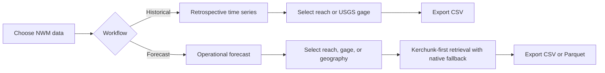

# streamflow_getter

**River streamflow time series from public hydrologic model data — through a Python package and command-line interface.**

`streamflow_getter` currently provides two National Water Model (NWM) workflows for the contiguous United States (CONUS): retrospective streamflow and operational forecasts. NRDS and GEOGLOWS adapters are planned, not yet available.

> **Project status:** Active development (`0.0.1`). The examples below reflect the implemented CLI; availability and historical compatibility depend on the selected data product.

## At a glance

| Workflow | Command | Selection | Output |
|---|---|---|---|
| NWM retrospective | `nwm` | NWM reach ID or USGS gage | CSV |
| NWM operational | `nwm-operational` | NWM reach, USGS gage, point, bounding box, or GeoJSON polygon | CSV or Parquet |
| NRDS / GEOGLOWS | Not implemented | Planned source-specific adapters | — |



## Quick start

**Requirements:** Python 3.11 or newer and [uv](https://docs.astral.sh/uv/). Run the following from the repository root.

```bash
uv sync --extra operational
uv run --locked streamflow-getter --help
```

Retrieve an operational short-range forecast for one NWM feature ID:

```bash
uv run --locked --extra operational streamflow-getter nwm-operational \
  --date 2026-04-19 --cycle 0 --reach 3586192 \
  --start-hour 1 --end-hour 2 --out forecast.csv
```

This requests the forecast leads `f001` and `f002`; the analysis timestep (`t0`) is included by default. Add `--no-t0` to omit it. The date and reach above are **documented validation examples**, not a guarantee of future data availability.

Retrieve a retrospective CSV:

```bash
uv run --locked streamflow-getter nwm \
  --gage 01646500 --version 2.1 \
  --start 2015-05-23 --end 2015-06-24 --out retrospective.csv
```

The retrospective command supports versions `3.0` and `2.1`; these are historical archives with different coverage periods. See [NWM notes](docs/nwm-notes.md) and check the requested archive's coverage.

## Choose a river location

Operational forecasts can be requested by:

| Input | Options | Local data needed |
|---|---|---|
| NWM feature ID | `--reach 3586192` | None |
| USGS station | `--gage 08165500 --routelink /path/to/RouteLink_CONUS.nc` | Compatible RouteLink NetCDF |
| Geographic point | `--point LONGITUDE LATITUDE --hydrofabric /path/to/NWM_v3_hydrofabric.gdb` | NWM channel hydrofabric |
| Bounding box | `--bbox WEST SOUTH EAST NORTH --hydrofabric ...` | NWM channel hydrofabric |
| Polygon | `--polygon /path/to/region.geojson --hydrofabric ...` | NWM channel hydrofabric |

Geographic selection requires the `spatial` extra and EPSG:4326 longitude/latitude coordinates. A nearest channel is not necessarily the correct hydrologic reach, particularly near confluences. For complete commands and safeguards, see the [operational guide](docs/OPERATIONAL_NWM.md#selecting-reaches).

## Forecast products and exports

Operational CONUS products available in the CLI include `short_range`, medium-range ensemble members 1–6, `medium_range_blend`, `medium_range_no_da`, and long-range ensemble members 1–4. Forecast lead schedules differ by product; **implemented support does not imply exhaustive historical validation**.

For Parquet output, install the `parquet` extra and specify the format:

```bash
uv run --locked --extra operational --extra parquet \
  streamflow-getter nwm-operational \
  --date 2026-04-19 --reach 3586192 \
  --start-hour 1 --end-hour 2 \
  --format parquet --out forecast.parquet
```

Streamflow is reported in cubic meters per second (m³/s). The operational output includes forecast/source metadata; consult the output code for the authoritative column schema. Retrospective output contains `time` (UTC), `feature_id`, and `streamflow`.

## Documentation

| Guide | What it covers |
|---|---|
| [Operational NWM retrieval](docs/OPERATIONAL_NWM.md) | Products, forecast timing, reach selection, caching, outputs, and limitations |
| [NWM notes](docs/nwm-notes.md) | Background on the NWM network and data |
| [Benchmarks](benchmarks/README.md) | Reproducible retrieval experiments and measurement methods |
| [Research progress](benchmarks/PROGRESS.md) | Historical experiments and validation evidence |
| [Project roadmap](docs/ROADMAP.md) | Requirements and future work |

## Development

```bash
uv sync --locked --extra operational --extra spatial --extra parquet
uv run --locked --extra operational --extra spatial --extra parquet pytest -q -ra
uv run --no-sync streamflow-getter nwm-operational --help
```

The implementation lives in `src/streamflow_getter/`, automated tests in `tests/` and `benchmarks/test_*.py`, and performance experiments in `benchmarks/`. Use focused branches and pull requests according to the repository's contribution policy; do not assume changes to the roadmap or other data adapters are authorized by these examples.

**Known boundaries:** operational geographic selection is CONUS-only; historical reach-network compatibility and full forecast-horizon coverage are not verified for every product; some analysis-to-forecast `t0` pairings require scientific review. See [validation and limitations](docs/OPERATIONAL_NWM.md#validation-and-limitations).
