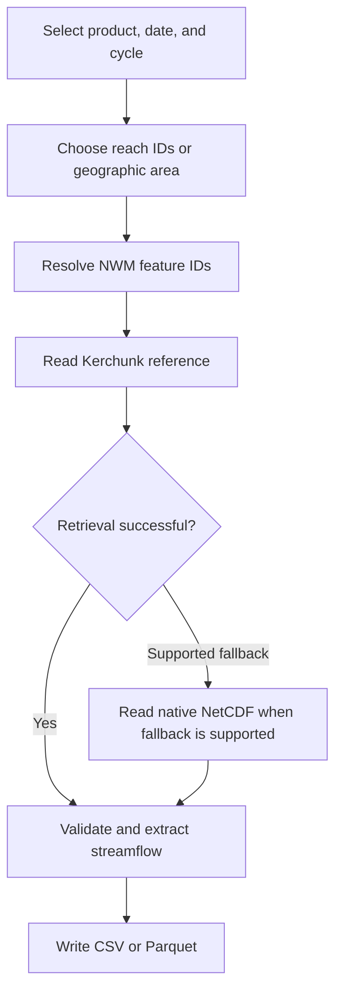

# Operational NWM Retrieval

Retrieve streamflow forecasts from the NOAA National Water Model (NWM) for river reaches in the contiguous United States (CONUS).

The `nwm-operational` command supports multiple forecast products, river-reach selection methods, validated Kerchunk reference caching, and CSV or Parquet output.

> **Scope:** This guide describes implemented capabilities. Some forecast products have been validated only for selected dates, cycles, and reaches. Full historical availability and scientific compatibility are not guaranteed.

## Contents

- [Quick start](#quick-start)
- [Installation](#installation)
- [Retrieval workflow](#retrieval-workflow)
- [Forecast products](#forecast-products)
- [Forecast timing](#forecast-timing)
- [Selecting reaches](#selecting-reaches)
- [Output formats](#output-formats)
- [Reference caching](#reference-caching)
- [Verified operational source availability](#verified-operational-source-availability)
- [Validation and limitations](#validation-and-limitations)

## Quick start

Retrieve a short-range forecast for NWM feature ID `3586192`:

```bash
uv run --locked --extra operational streamflow-getter nwm-operational \
  --date 2026-04-19 \
  --cycle 0 \
  --reach 3586192 \
  --start-hour 1 \
  --end-hour 2 \
  --out forecast.csv
```

The command requests forecast hours `f001` and `f002`. By default, it also includes an analysis timestep (`t0`). Add `--no-t0` to exclude that timestep.

The date and feature ID are documented validation examples. Data availability depends on the source archive.

## Installation

Requires Python 3.11 or newer and [uv](https://docs.astral.sh/uv/).

From the repository root, install the dependencies needed for your workflow:

| Extra | Purpose |
|---|---|
| `operational` | Operational NetCDF access and fallback |
| `spatial` | Point, bounding-box, and polygon selection |
| `parquet` | Parquet export |

For standard operational retrieval:

```bash
uv sync --extra operational
```

For all optional capabilities:

```bash
uv sync --extra operational --extra spatial --extra parquet
```

To inspect available CLI options:

```bash
uv run --locked streamflow-getter nwm-operational --help
```

## Retrieval workflow



The operational reader prefers Kerchunk references and uses native NetCDF for supported fallback conditions. The local reference cache can avoid downloading unchanged reference metadata.

## Forecast products

The following configurations are available through the operational CLI for CONUS.

| Product | Forecast cycles (UTC) | Available forecast leads |
|---|---|---|
| `short_range` | Every hour | f001–f018, hourly |
| `medium_range_mem1` | 00, 06, 12, 18 | f001–f240, hourly |
| `medium_range_mem2`–`medium_range_mem6` | 00, 06, 12, 18 | f001–f204, hourly |
| `medium_range_blend` | 00, 06, 12, 18 | f001–f240, hourly |
| `medium_range_no_da` | 00, 06, 12, 18 | f003–f240, every 3 hours |
| `long_range_mem1`–`long_range_mem4` | 00, 06, 12, 18 | f006–f720, every 6 hours |

The table describes the implemented product configurations. It does not establish complete source availability for every date or historical NWM version.

### Medium-range example

```bash
uv run --locked --extra operational streamflow-getter nwm-operational \
  --date 2026-04-19 \
  --cycle 0 \
  --product medium_range_mem2 \
  --reach 3586192 \
  --start-hour 1 \
  --end-hour 2 \
  --out medium_range.csv
```

### Long-range example

```bash
uv run --locked --extra operational streamflow-getter nwm-operational \
  --date 2026-04-19 \
  --cycle 0 \
  --product long_range_mem2 \
  --reach 3586192 \
  --start-hour 1 \
  --end-hour 12 \
  --no-t0 \
  --out long_range.csv
```

The long-range example selects `f006` and `f012`. It excludes `t0` because the scientific interpretation of the default analysis-to-long-range pairing has not been fully validated.

## Forecast timing

Forecast-hour windows are inclusive. The CLI selects only leads supported by the requested product.

| Product schedule | Example request | Selected leads |
|---|---|---|
| Hourly | Hours 1–3 | f001, f002, f003 |
| Every 3 hours | Hours 4–12 | f006, f009, f012 |
| Every 6 hours | Hours 1–12 | f006, f012 |

If the requested interval contains no valid forecast leads, the request is rejected.

### Analysis timestep (`t0`)

The operational CLI includes an initial analysis timestep by default.

- Most supported forecast products use `analysis_assim`.
- `medium_range_no_da` uses `analysis_assim_no_da`.
- The analysis and forecast records can have different reference times.
- Use `--no-t0` when only forecast lead records are required.

The analysis-to-forecast pairing for long-range ensembles has been tested for technical compatibility but has not been fully established as the scientifically intended initialization.

## Selecting reaches

Operational forecasts can be requested by NWM feature ID, USGS gage, geographic point, bounding box, or GeoJSON polygon.

| Method | Options | Required local dataset |
|---|---|---|
| Feature ID | `--reach` | None |
| USGS station | `--gage`, `--routelink` | Compatible RouteLink NetCDF |
| Point | `--point`, `--hydrofabric` | NWM channel hydrofabric |
| Bounding box | `--bbox`, `--hydrofabric` | NWM channel hydrofabric |
| Polygon | `--polygon`, `--hydrofabric` | NWM channel hydrofabric |

### NWM feature IDs

Use `--reach` to request a specific NWM channel. Repeat the option for multiple reaches.

```bash
uv run --locked --extra operational streamflow-getter nwm-operational \
  --date 2026-04-19 \
  --reach 3586192 \
  --reach 1122645 \
  --start-hour 1 \
  --end-hour 2 \
  --out reaches.csv
```

### USGS gage IDs

Use `--gage` with a compatible local RouteLink NetCDF file.

```bash
uv run --locked --extra operational streamflow-getter nwm-operational \
  --date 2026-04-19 \
  --gage 08165500 \
  --routelink /path/to/RouteLink_CONUS.nc \
  --start-hour 1 \
  --end-hour 2 \
  --out gage_forecast.csv
```

Preserve leading zeros in USGS station identifiers. RouteLink provides the mapping between station IDs and NWM feature IDs. For `--gage`, RouteLink compatibility is now checked from the complete
validated gage-to-feature crosswalk rather than from the filename or a
selected set of gauges. The crosswalk is serialized canonically and
compared by SHA-256 against known published CONUS RouteLink mappings.

Known fingerprints currently identify the published NWM 3.0.17 and
NWM 3.1.6 crosswalks. The operational model version is independently
derived from each forecast initialization time.

A known RouteLink/request-version mismatch is rejected before remote NWM
retrieval. A request spanning both NWM 3.0 and NWM 3.1 is likewise rejected
when only one known version-specific RouteLink is supplied.

An unrecognized RouteLink fingerprint remains allowed for backward
compatibility, but its network version is recorded as unknown rather than
inferred. For `--gage` runs, the manifest records the RouteLink filename,
canonical crosswalk SHA-256, classified network version, gage count,
compatibility status, requested model versions, requested gages, and their
resolved NWM feature IDs.

This policy applies to RouteLink-based `--gage` resolution only.
Hydrofabric version compatibility for `--point`, `--bbox`, and `--polygon`
remains a separate evidence question.

### Geographic point

Use longitude and latitude in EPSG:4326.

```bash
uv run --locked --extra operational --extra spatial \
  streamflow-getter nwm-operational \
  --date 2026-04-19 \
  --point -99.3217121935161 30.0699307434853 \
  --hydrofabric /path/to/NWM_v3_hydrofabric.gdb \
  --max-distance-m 500 \
  --start-hour 1 \
  --end-hour 1 \
  --out point_forecast.csv
```

The command selects the nearest NWM channel within the configured maximum distance.

**Important:** The nearest geographic channel is not necessarily the correct hydrologic reach, especially near tributary junctions.

### Geographic bounding box

Supply coordinates in this order:

`WEST SOUTH EAST NORTH`

```bash
uv run --locked --extra operational --extra spatial \
  streamflow-getter nwm-operational \
  --date 2026-04-19 \
  --bbox -99.35 30.05 -99.30 30.09 \
  --hydrofabric /path/to/NWM_v3_hydrofabric.gdb \
  --max-reaches 100 \
  --start-hour 1 \
  --end-hour 1 \
  --out bbox_forecast.csv
```

The command selects NWM channels intersecting the bounding box.

### GeoJSON polygon

```bash
uv run --locked --extra operational --extra spatial \
  streamflow-getter nwm-operational \
  --date 2026-04-19 \
  --polygon /path/to/region.geojson \
  --hydrofabric /path/to/NWM_v3_hydrofabric.gdb \
  --max-reaches 100 \
  --start-hour 1 \
  --end-hour 1 \
  --out polygon_forecast.csv
```

Supported inputs include Polygon and MultiPolygon geometries, Features containing those geometries, and FeatureCollections containing exactly one polygonal Feature.

Coordinates must represent longitude and latitude in EPSG:4326. Coordinate values alone cannot independently establish the source coordinate reference system.

### Geographic selection safeguards

The default limit for bounding-box and polygon requests is 100 reaches. Use `--max-reaches` to configure the limit.

Requests exceeding the limit are rejected rather than silently truncated. This limit is a CLI safeguard, not a measured maximum retrieval capacity.

Duplicate NWM feature IDs are rejected. Geographic selection currently supports CONUS only.

## Output formats

Operational retrieval supports CSV and Parquet. Streamflow values are expressed in cubic meters per second (m³/s).

### CSV

```bash
uv run --locked --extra operational streamflow-getter nwm-operational \
  --date 2026-04-19 \
  --reach 3586192 \
  --start-hour 1 \
  --end-hour 2 \
  --format csv \
  --out forecast.csv
```

### Parquet

Parquet requires the `parquet` optional dependency group.

```bash
uv run --locked --extra operational --extra parquet \
  streamflow-getter nwm-operational \
  --date 2026-04-19 \
  --reach 3586192 \
  --start-hour 1 \
  --end-hour 2 \
  --format parquet \
  --out forecast.parquet
```

Operational records include streamflow values and source/forecast metadata. The output implementation defines the authoritative column schema.

## Reference caching

The operational reader can store validated Kerchunk reference records locally.

The cache implementation checks reference structure, source identity, SHA-256 integrity, remote ETag, source generation, and consistency of remote metadata during downloads.

Before checking the reference ETag, the metadata reader clears the reference path's and ancestor paths' in-memory S3 listing entries and requests fresh object metadata with `refresh=True`. This prevents stale listings from supplying an old ETag, an incorrect missing-file result, or an outdated size/ETag to a subsequent reference-body open. This listing-cache invalidation does not delete validated reference records on disk; the existing integrity and before/after metadata checks still govern their reuse and replacement.

Cached references are reused when their metadata remains valid. Missing or invalid local records can be replaced with validated downloads; source-generation changes are rejected when compatibility cannot be established.

Permission errors, directory misuse, and other local cache-read I/O errors propagate and stop reference-body download or cache replacement. A remote freshness-metadata check precedes the local cache read.

Operational CLI retrieval uses `~/.cache/streamflow_getter` by default. Use `--cache-dir PATH` to select another persistent reference-cache directory, or `--no-cache` to disable persistent reference caching for that request. `--cache-dir` and `--no-cache` are mutually exclusive. The default, explicit override, and opt-out modes have been exercised through live CLI retrieval; see [PROGRESS Section 4.7](../benchmarks/PROGRESS.md#47-operational-cli-cache-policy).

This default is a CLI policy. The lower-level Python retrieval functions retain their explicit `cache_dir=None` behavior so library callers do not begin writing persistent cache records implicitly.

### Planning an explicit operational date range

`plan_operational_configs` expands an inclusive UTC calendar-date range into
validated `ForecastConfig` objects without performing remote access. The
existing `ForecastConfig` rules remain authoritative for supported products,
cycles, domains, and date syntax.

Example:

    from streamflow_getter.request_planning import plan_operational_configs

    configs = plan_operational_configs(
        "2026-04-19",
        "2026-04-21",
        cycles=(0, 6),
        products=("short_range", "medium_range_mem1"),
    )

The output order is date, cycle, then product. Every requested combination
must be valid; unsupported cycle/product combinations fail the complete plan
rather than being silently omitted. Archive availability is not checked
during planning.

This API is the deterministic primitive for future explicit-period,
recent-day, and event requests. Recent windows should be resolved to
absolute UTC dates before planning, and a named event can later provide
those same absolute dates plus the request's reach or region selection.

### Planning a named event

`OperationalEvent` is a small immutable representation of a named
absolute UTC date window. It deliberately does not implement an event
catalogue or another retrieval path:

    from streamflow_getter.request_planning import (
        OperationalEvent,
        plan_operational_event,
    )

    event = OperationalEvent(
        name="Alabama April 2026",
        start_date="2026-04-19",
        end_date="2026-04-21",
    )

    configs = plan_operational_event(
        event,
        cycles=(0,),
        products=("short_range",),
    )

Event planning delegates to the same `plan_operational_configs` function
used by explicit periods and recent-day requests. Product, cycle, domain,
and date validation therefore remain centralized.

Reach and region selection remain independent of the event window. The
same event can be combined with the existing reach, gage, point, bounding
box, or polygon selection paths. A future SEED/CSES or other event
catalogue can construct this object after resolving a name to absolute
dates and spatial selection; it does not require a second NWM reader.

The CLI does not yet expose a named-event option because the current
exported row schema has no request/event provenance field. Event names
should be exposed together with the planned run/provenance manifest
rather than silently discarded from output.

### Selecting an explicit date range from the CLI

The operational CLI preserves the existing single-date interface:

    streamflow-getter nwm-operational           --date 2026-04-19           --cycle 0           --product short_range           --reach 3586192           --out flow.csv

An inclusive UTC calendar-date range can instead be requested with
`--start-date` and `--end-date`:

    streamflow-getter nwm-operational           --start-date 2026-04-19           --end-date 2026-04-21           --cycle 0           --product short_range           --reach 3586192           --out flow.csv

`--date` and `--start-date` are mutually exclusive, and `--end-date`
is required when `--start-date` is used. The current CLI intentionally
keeps one product and one cycle per request; the Python request planner
already supports finite collections of both.

Explicit-period requests use `plan_operational_configs` followed by
`fetch_operational_configs`. Because the current CLI still exposes one
requested product, the internal `requested_product` orchestration field
is removed before export so the established operational output schema is
preserved. A broader normalized/provenance schema should be introduced
deliberately rather than as an incidental consequence of period support.

### Selecting a recent UTC window

`--recent-days N` selects the most recent `N` UTC calendar dates,
including the current UTC date. For example, a three-day window resolved
as of `2026-04-21` covers `2026-04-19` through `2026-04-21`, inclusive.

    streamflow-getter nwm-operational \
      --recent-days 3 \
      --cycle 0 \
      --product short_range \
      --reach 3586192 \
      --out recent.csv

The CLI resolves the relative window to absolute UTC start/end dates
before request planning and prints those dates. The Python helper
`resolve_recent_date_range(days, as_of=...)` accepts an explicit `as_of`
date for deterministic replay and testing; when omitted it uses the
current UTC calendar date.

Recent selection does not weaken strict retrieval behavior. If an object
within the resolved period is unavailable or another retrieval/validation
failure occurs, that error remains visible rather than silently shortening
the requested window.

### Operational NWM version provenance

Operational archive paths remain date/cycle based across the verified
model-upgrade boundary, so `ForecastConfig` does not expose a
user-selectable NWM version. Instead,
`resolve_operational_nwm_version` derives the model version from the
requested forecast initialization time.

The roadmap-period transition registry is:

| Operational version | Effective initialization (UTC) | NWS notice |
|---|---|---|
| 1.1 | active at the January 1, 2018 project baseline | prior operational version |
| 1.2 | 2018-03-06 12Z | SCN18-16 |
| 2.0 | 2019-06-19 12Z | SCN19-42 |
| 2.1 | 2021-04-20 12Z | SCN20-119 |
| 3.0 | 2023-09-20 12Z | SCN23-76 |
| 3.1 | 2026-08-18 12Z | SCN26-64 |

Dates before the January 1, 2018 project baseline resolve to an unknown
version rather than receiving a guessed value.

Each run-manifest configuration records its derived `nwm_version`.
The manifest-level `model` section lists every resolved operational
version represented by the request and counts any configurations whose
version is unresolved. Requests that cross an upgrade boundary can
therefore retain both versions without changing native or Kerchunk URL
construction.

Version provenance does not establish RouteLink or hydrofabric
compatibility. NWM upgrades can change network definitions and spatial
assets, so local resolution inputs remain a separate compatibility
concern.

### Combined row and run-provenance contract

Operational output now distinguishes two row contracts.

The established single-configuration contract contains:

    forecast_date
    forecast_cycle
    product
    domain
    lead_hour
    feature_id
    valid_time
    reference_time
    streamflow_m3s
    method

The combined-request contract adds `requested_product` immediately before
the actual source `product`. Its stable row identity is:

    forecast_date
    forecast_cycle
    requested_product
    domain
    lead_hour
    feature_id

`requested_product` describes the forecast product/member requested by the
run. `product` describes the actual NWM source product used for that row.
They normally match for forecast rows and may differ for analysis t0.

`reference_time` is literal source metadata. It must not be rewritten to
equal `forecast_date` plus `forecast_cycle`; operational analysis products
can legitimately report a source reference time different from the t0
valid time.

`build_operational_run_manifest` validates a successful combined frame
against the exact row identities implied by the planned configurations,
reaches, lead window, and t0 policy. Manifest schema version 1 records the
resolved request, selection context, cache policy, software provenance,
diagnostics, row contract, result method/source counts, and strict
completeness.

The version-1 manifest describes complete strict runs only. Missing or
unplanned rows cause manifest construction to fail. Future partial-result
support can extend the existing `completeness` and `failures` fields
without redefining the successful row identity.

CSV/Parquet serialization remains separate from these semantics. The
existing one-product CLI export is unchanged in this step; manifest
publication and CLI integration are separate follow-up work.

### Publishing a run manifest sidecar

`write_manifest` publishes strict JSON from a fully serialized temporary
file and refuses to overwrite an existing destination. The default sidecar
name preserves the data extension, for example:

    forecast.csv
    forecast.csv.manifest.json

or:

    forecast.parquet
    forecast.parquet.manifest.json

`write_timeseries_with_manifest` treats the data file and manifest as one
logical published result. It validates both destinations and serializes the
manifest before creating the data output. If sidecar publication then
fails, the newly created data file is removed before the original error is
propagated. Pre-existing files are never intentionally removed or
overwritten.

These guarantees are in-process failure/rollback semantics. Two separate
filesystem paths cannot be treated as a portable crash-atomic transaction;
a sudden process, kernel, or storage failure between the two publications
can still require external recovery.

This publication helper does not change retrieval, request planning, or the
current CLI. CLI/run-manifest integration is a separate step after the row
and manifest contracts are validated independently.

### Operational CLI run manifests

A successful `nwm-operational` CLI request now publishes two files:

    forecast.csv
    forecast.csv.manifest.json

or, for Parquet:

    forecast.parquet
    forecast.parquet.manifest.json

The streamflow data file intentionally preserves the established
one-product operational schema. `requested_product` is retained internally
while the strict run manifest is built, then removed from the CSV/Parquet
export. This avoids breaking existing data consumers while preserving the
distinction between what the run requested and the actual NWM source
product used for each row.

The manifest records the resolved temporal selection, validated
configurations, resolved NWM reaches, lead window, t0 policy, cache policy,
package version when available, retrieval-method/source counts, stable
combined-row contract, and exact strict completeness counts.

For `--recent-days`, both the relative day count and the resolved absolute
UTC dates are recorded. For a single-date or explicit-period request, the
requested and resolved dates are recorded directly.

Both output paths are checked before remote retrieval. Manifest publication
uses the rollback behavior documented above: if sidecar publication fails
after the data file is created, the newly created data file is removed and
the error is propagated.

This step does not enable partial results. A successful CLI manifest has
`status: "complete"` and strict expected-versus-actual row counts; an
incomplete combined result is rejected before publication.

### Executing planned forecast configurations

`fetch_operational_configs` executes a finite collection of validated
`ForecastConfig` objects through the existing single-configuration
`fetch_operational_series` primitive. It validates every product-specific
forecast-hour window before retrieval and uses strict failure behavior:
a retrieval or validation failure propagates rather than returning an
apparently complete partial result.

```python
from streamflow_getter.operational_requests import fetch_operational_configs
from streamflow_getter.request_planning import plan_operational_configs

configs = plan_operational_configs(
    "2026-04-19",
    "2026-04-21",
    cycles=(0,),
    products=("medium_range_mem1", "medium_range_mem2"),
)

frame = fetch_operational_configs(
    configs,
    [3586192],
    3,
    12,
    cache_dir="~/.cache/streamflow_getter",
)
```

The combined frame adds `requested_product` while retaining `product` as
the actual source product. For forecast rows these normally match. For t0,
`requested_product` identifies the forecast/member that requested the row
while `product` remains `analysis_assim` or `analysis_assim_no_da`.

Analysis t0 data are decoded once per unique resolved analysis source and
reused across requested configurations sharing that source. The attached
rows remain separate in the combined result through `requested_product`.
No-DA analysis remains a distinct source. This reuse concerns decoded
analysis rows; existing reference preparation/cache deduplication remains
responsible for reference JSON reuse.

### Preparing a reference before retrieval

The Python API can prepare one forecast or analysis reference without opening model arrays. Preparation and the Kerchunk reader share the same source resolution, reference validation, and cache implementation:

```python
from streamflow_getter.operational_nwm import (
    ForecastConfig,
    prepare_operational_reference,
    read_kerchunk_forecast,
)

config = ForecastConfig(date="2026-04-19", cycle=0, product="short_range")
cache_dir = "~/.cache/streamflow_getter"

prepared = prepare_operational_reference(config, 1, cache_dir=cache_dir)
print(prepared["source"])

result = read_kerchunk_forecast(
    config, 1, [3586192], cache_dir=cache_dir
)
```

The returned dictionary contains `source` (the resolved source descriptor), `reference` (the validated Kerchunk JSON), and `reference_json_bytes`. That size field preserves the reader's existing accounting: raw JSON length without caching, serialized reference length with caching. It is not a measurement of network transfer on cache hits.

Pass `hour=0` to prepare the matching analysis reference, including `analysis_assim_no_da` for a no-DA forecast. Analysis and forecast references use separate cache records. With `cache_dir=None`, preparation returns the validated reference without writing a cache record; persistent reuse requires an explicit cache directory.

Cached preparation may download the reference JSON and performs remote freshness checks, including native-source metadata requests. It does not open the NetCDF data arrays, extract flows, or validate decoded timestamps and reach availability; the reader performs those checks during retrieval. Subsequent retrieval checks freshness again, so preparation does not establish offline access.

If the S3 reference metadata lookup or reference-body open/read raises `FileNotFoundError`, preparation raises `RemoteReferenceNotFoundError` from `streamflow_getter.reference_cache`. This subclass of `FileNotFoundError` identifies the missing remote reference and retains the original exception as `__cause__`. Its message identifies the reference path and acquisition stage.

Native NetCDF source metadata failures, local cache read/write failures, authorization errors, other transport errors, and parsing/integrity errors retain their existing exception behavior. In particular, a local cache-write `FileNotFoundError` is not classified as a missing remote reference.

The retrieval coordinator, `fetch_operational_forecast`, uses native NetCDF fallback for `RemoteReferenceNotFoundError`, including when caching is enabled. All other cached retrieval errors propagate. This also covers a reference that disappears during the second metadata lookup after its body was downloaded: the existing cache record remains unchanged because replacement requires successful before/after checks. The preparation APIs themselves continue to raise the exception and never invoke native retrieval.

Fallback retrieves the current native object and applies the native reader's reach, flow, and timestamp checks. It does not establish equivalence to an older cached source generation or enable offline cache reuse. Successful fallback records the exception type and message in `fallback_reason`; if native retrieval also fails, the resulting `RuntimeError` retains the native exception as its cause and the Kerchunk reason as an exception note. The existing uncached fallback policy is unchanged.

This function prepares one explicitly selected reference. Use the batch API below to prepare a collection of forecast configurations.

### Preparing a batch of references

`prepare_operational_references` accepts a finite iterable of `ForecastConfig` objects and a shared inclusive forecast-hour window. This supports explicit selections across dates, cycles, products, and ensemble members:

```python
from streamflow_getter.operational_nwm import (
    ForecastConfig,
    prepare_operational_references,
)

configs = [
    ForecastConfig(date=day, cycle=0, product=product)
    for day in ("2026-04-19", "2026-04-20")
    for product in ("medium_range_mem1", "medium_range_mem2")
]
summaries = prepare_operational_references(
    configs, 1, 3, cache_dir="~/.cache/streamflow_getter"
)
print(len(summaries), "unique references prepared")
```

The complete configuration collection and each product's available leads are validated before metadata requests, reference downloads, or cache writes. A window invalid for any configuration stops the batch before acquisition; it is not silently shortened to fit that product. An explicit, nonempty cache directory is required.

Analysis t0 is included by default; pass `include_t0=False` to omit it. Sources are deduplicated by their full reference path and native URL, preserving first occurrence order. Ensemble members sharing an analysis reference prepare it once, while no-DA analysis, different dates/cycles, and distinct forecast files remain separate. This shares reference preparation; reuse of decoded t0 flow rows across ensemble series remains a separate task.

The returned list contains one compact summary per unique source: `forecast_date`, `forecast_cycle`, `domain`, `source`, and `reference_json_bytes`. The date and cycle describe the selection, not decoded dataset timestamps. Full reference JSON stays in the cache rather than accumulating in the result list; the existing single-reference size accounting applies.

Request validation does not establish remote availability. If acquisition fails partway through a batch, its exception propagates and later sources are not attempted. Missing remote references use the classification and preserved cause described above; batch preparation does not invoke the retrieval coordinator's native fallback. Earlier validated cache records remain available for a retry, with freshness checks still required. Date-range CLI selection, named events, default caching, and any broader cached-path fallback policy remain separate backend tasks under the roadmap.

## Verified operational source availability

Availability was audited using metadata-only checks against the source
paths currently generated by `streamflow_getter`. No model arrays were
downloaded for this availability audit.

The boundaries below mean:

> the first observed forecast initialization where the **current product
name, directory, filename, cycle, and representative valid lead** exist.

They do not prove that differently named historical products or files did
not exist before these boundaries.

### GCS native and CIROH Kerchunk boundaries

GCS native objects and CIROH Kerchunk references produced identical
presence/absence results at every exact transition tested.

| Current product path | Representative lead | Immediately preceding valid initialization | First observed available initialization | Derived NWM version |
|---|---:|---|---|---|
| `short_range` | f001 | 2018-09-16 23Z | **2018-09-17 00Z** | 1.2 |
| `long_range_mem1`–`long_range_mem4` | f006 | 2018-09-16 18Z | **2018-09-17 00Z** | 1.2 |
| `medium_range_mem1`–`medium_range_mem6` | f003 | 2019-06-19 06Z | **2019-06-19 12Z** | 2.0 |
| `medium_range_no_da` | f003 | 2021-04-20 06Z | **2021-04-20 12Z** | 2.1 |
| `medium_range_blend` | f003 | 2023-09-19 00Z | **2023-09-19 06Z** | 2.1 |

The medium-range ensemble-member boundary aligns exactly with the
registered NWM 2.0 transition. The no-DA boundary aligns exactly with the
registered NWM 2.1 transition.

`medium_range_blend` is different: its current path was already available
at 2023-09-19 06Z, while the registered NWM 3.0 transition is
2023-09-20 12Z. Its appearance therefore must not be attributed to the
NWM 3.0 transition.

### NOAA `noaa-nwm-pds` boundary

All 13 currently supported CONUS forecast products were absent at their
final valid initialization on December 31, 2024 and present at
**2025-01-01 00Z** using the current NOAA S3 paths.

- Short range: 2024-12-31 23Z missing -> 2025-01-01 00Z present.
- Medium- and long-range products: 2024-12-31 18Z missing ->
  2025-01-01 00Z present.

This establishes the observed current-path boundary for the products and
representative leads tested. It does not establish absence of every other
NOAA object layout before 2025.

### Evidence scope

A broader matrix sampled 13 products across 12 dates from September 2018
through November 2026 and checked GCS native, CIROH Kerchunk, and NOAA S3
metadata. It contained 156 product/date rows and no probe errors.

Exact transition testing then checked valid initialization cycles around
the identified boundaries. The resulting evidence log contains 488
metadata probes and no source-code changes.

These tests establish bounded source-path transitions, not exhaustive
gap-free continuity for every initialization after each boundary.

## Validation and limitations

### Validated behavior

Automated and selected real-data tests have verified:

- Kerchunk and native NetCDF retrieval agreement for selected forecast products and leads.
- Forecast timestamps, source identity, and product-specific lead schedules.
- USGS station resolution through RouteLink.
- Geographic point, bounding-box, and polygon selection.
- CSV and Parquet output.
- Reference-cache integrity, reuse, and recovery.
- Controlled missing-reference fallback with a populated cache for the selected live case in [PROGRESS Section 5.5](../benchmarks/PROGRESS.md#55-controlled-cached-native-fallback).

The tests demonstrate these behaviors for the cases examined, not every possible NWM file.

### Known limitations

1. Operational geographic retrieval is currently limited to CONUS.
2. Full forecast horizons have not been retrieved and verified for every supported product.
3. Historical model versions may differ in product availability, feature IDs, and network definitions.
4. RouteLink and hydrofabric versions must be compatible with the intended NWM data.
5. The nearest geographic channel may not represent the intended hydrologic reach.
6. The scientific suitability of `analysis_assim` as `t0` for long-range ensemble forecasts requires further confirmation.
7. The default geographic reach limit is a safeguard, not a performance benchmark.
8. Further NWM retrospective and GEOGLOWS development requires the technical coordination specified in the project roadmap.

## Related documentation

- [Main README](../README.md) — project overview and quick start.
- [Project roadmap](ROADMAP.md) — requirements and development priorities.
- [NWM notes](nwm-notes.md) — background on NWM data and network versions.
- [Benchmark documentation](../benchmarks/README.md) — reproducible retrieval experiments.
- [Research progress](../benchmarks/PROGRESS.md) — historical validation evidence.
